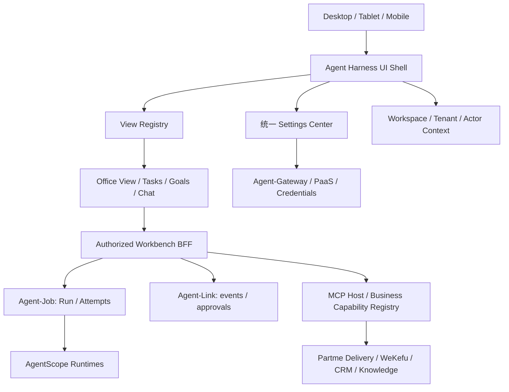

# cyberdaddyleo/workstation-BOSS v2.0 深度调研与 Agent Harness UI 整合记录

> 2026-11-17 · 研究基线：`8acd1680b3fda845b56987f60f8a30e221f9fb46`
> 本地参考库：`../research/workstation-BOSS`（与本仓库同级）
> 当前产品宿主：`agent-hernes-ui`（GitHub：partme-ai/agent-harness-ui）
> 证据分类：**源码核验** / **浏览器交互实测** / **独立设计** / **待运行验证**

## 1. 研究目标与许可

BOSS 工作台的价值是让经营目标、组织结构、任务、成员和经营态势变得直观，而不是已经提供生产级 Agent 平台。Partme 保留统一 Shell、Settings Center、跨端布局和 Agent Fabric 基础设施，用原创代码建立可切换 View。

上游仓库 `LICENSE` 为 **自定义非商业使用许可**：允许个人学习和非商业修改，但未经许可不得打包到收费产品。研究资产保留在同级 `research` 下；**不搬运**原项目的 HTML、JS、CSS、截图、图标、人物画稿、水印、文案或修改版到 `agent-hernes-ui`。如希望直接使用原资产，应先取得书面商用授权。

## 2. 源码现状（源码核验）

- 入口 `index.html` 约 **7,948 行 / 741 KiB**，UI、布局、交互、状态和业务运算主要集中在一份文件中。
- `UI.register` 注册 9 个页面：`office`(4363)、`team`(4765)、`radar`(5173)、`goals`(5506)、`tasks`(6190)、`crm`(6512)、`biz`(6761)、`ai`(7358)、`settings`(7719)。
- 静态扫描识别 266 处 UI.act 绑定，约 245 个不同动作名，另外有 UI.chg / UI.inp / UI.key。
- 全局 `S` 状态及 `save(now)` / `load()` 在 2385–2425 行附近，默认业务保存为浏览器本地状态。
- `Off`(3883) 管理办公室镜头、当前选中、hover 和观察模式；`drawScene`(3981) 渲染场景；`onSeatClick`(4120) 处理工位点击；`renderPersona`(4518) 渲染右侧人物画像。
- `Gl`(5493) 与 `wizStep1`(5605)、`wizStep2`(5696)、`wizStep3`(5786)、`wizStep4`(5950) 组成目标分解向导。
- `Tk`(6108) 组织任务；`setTaskStatus`(6224) 会直接修改任务状态和本地进度。
- `AIC`(7010) 是自配模型 API 的调用入口；`ai-proxy.js` 可选本机中转。不存在与 Partme Agent-Job 同等级的持久化执行调度承诺。
- README 明确开源版为单用户、无多人实时同步；市场雷达需要点击联网搜索而不是后台 7×24 监测。

## 3. 页面与交互资产映射

| BOSS 页面 | 实际交互价值 | Partme 的原创转化 | 本轮状态 |
| --- | --- | --- | --- |
| 办公室 | 多房间平面图、拖动缩放、工位 hover、单击选中、右栏切换、底部观察模式 | `office-map`：可复用房间、工位、指挥区、空间/列表、团队详情、可信运行状态 | 已实现前端；数据 BFF 待接 |
| 团队画像 | 部门筛选、技能/行事风格/标签、负载与成员列表 | 人/Agent/执行节点的身份、可用能力、运行策略、容量与审计画像 | 工位/部门画像已接 UI，复杂画像待域契约 |
| 目标拆解 | 输入目标、约束/预算、部门选择、拆解粒度、能力匹配、预览编辑、确认派发 | Goal → Plan Draft → PlanVersion → 人审 → WorkflowRun/TaskVersion | 契约设计；真实服务未接 |
| 任务派发 | 按部门/状态/人切换，同一卡片关联目标与负责人 | 统一任务投影 + 多视图 + 证据完成状态 | 设计待接；不复用本地“拖动即完成” |
| 市场雷达 | 关键词搜索、热点提炼、转目标/任务 | MCP 业务信号流，来源/时效/可信度标注，人工确认转计划 | 设计待接 |
| 客户商机 | 漏斗、跟进、合同及回款 | 对应 CRM/WeKefu MCP 领域能力，Harness 不复制 CRM 数据库 | 设计待接 |
| 经营数据 | 目标、签约、现金回款、成本、环比可视化 | 业务 MCP 指标契约，区分 source/period/permissions | 设计待接 |
| AI 参谋 | 问题模板、条件上下文、AI 回复导入实体 | 授权 Agent + Tools/RAG + 可审计的建议/审批与执行 | 设计待接 |
| 设置 | 公司资料、员工、AI 端点、备份 | 使用统一 `SettingsCenter`/设置作用域，不再建第二套 | 现有设置保持 |

### 浏览器交互实测（1440×813）

1. 打开参考版时进入老板形象与样例公司初始化页；选择样例公司后进入完整办公室。
2. 办公室中，左侧是业务导航，中间是真正的可拖动/缩放平面图；中央总经理区为视觉焦点，右侧有“今日概览/团队画像”。
3. 底部提供“日常/负载/画像/考勤/业绩/激励”的不同观察镜头，切换不离开办公室。
4. “目标拆解”先展示推进目标，再进入步骤式向导，字段包含目标、背景、期限、预算、优先级、参与部门、拆解粒度、人员分配策略；未配置 AI 时允许模板拆解或手工粘贴 AI 结果。
5. “任务派发”既能按部门排成多列，也提供按状态、按人切换，并支持卡片详情与复制分工消息。

上面是原版运行时的**参考观察**，不是 Partme 已实现/已联通的功能证明。原版截图仅作研究查看，不添加到产品资源目录。

## 4. 不适合直接复用的实现

### 4.1 负载并不是 Agent Runtime 利用率

`loadOf`(2631) 计算 `ex + own * 0.4 + extra`，主要来自未完成任务条数，没有 CPU/GPU、并发预算、Token 配额、外部工具限制或执行租约概念。Partme 的 `active/capacity` 必须来自真实授权的 Agent/Node/Worker 状态，未知显示 `—`。

### 4.2 完成率是本地管理估计，而非验收证据

`taskProg`(2724) 将任务状态/人工百分比映射为进度；`goalProgress`(2737) 在有 KR 时采用 KR 与任务平均各一半的估计。该估计不能替代 Delivery Graph 的 Evidence Policy，不能由 UI 自己设置“执行成功”或“交付完成”。

### 4.3 本地派发 ≠ 真实调度

`plan-go`(5922) 根据编辑后的部门车道写入 `S.goals` 和 `S.tasks`，随后调用 `save()`。在 Partme，派发需要鉴权、冻结版本、幂等命令和 Agent-Job WorkflowRun 回执；回执也不代表业务完成。

### 4.4 设备状态、任务权限与隐私

参考版适用于单个老板本地管理，自定义 API Key 和完整备份需要特别保密。Partme 不应让业务 View 读取真实凭据，MCP 和模型密钥由统一设置/安全宿主管理。业务 MCP 需要租户/项目/用户授权、审计与敏感数据过滤。

## 5. 目标架构与边界（独立设计）

- **View** 是交互和展示方式，不是业务数据库；切到看板/办公室/聊天时，同一 Workspace 与 Run 不变。
- **Capability Pack** 决定业务对象、MCP 资源/工具、权限、指标及页面能力；同一个 Office View 可服务研发团队、客服团队和经营团队。
- **Settings** 是所有视图共用的配置入口，不能为数字办公室复制另一套模型/MCP/插件/技能/密钥设置。
- **BFF** 执行授权的只读聚合及命令代理；前端不能直接跨租户访问业务 MCP，也不能伪造在线/任务状态。
- **Agent-Job** 是任务执行权威；**Agent-Link** 处理消息/事件/审批协作；**Delivery Graph** 决定交付验收事实。

## 6. 本轮落地功能与证据

使用本仓库既有 Draft PR #1 的 `office-map` 作为基础，继续原生增强：

- `workspace/shared/office_scene.js`：纯函数的部门场景布局与可信统计；没有虚构房间或员工。
- `workspace/shared/OfficeControlPanels.jsx`：原创工作空间指挥台、团队画像目录、部门详情、真实容量/风险投影。
- `workspace/shared/office_panorama.css`：原创浅色空间、柔和部门色、中央指挥桌和底部模式选择。
- `workspace/shared/OfficeMapView.jsx`：保持 Workbench 和现有 Settings，增加指挥台、点击部门、右栏切换、底部观察镜头。
- `workspace/shared/office_projection.js`：补充重复部门 ID 的拒绝校验。
- `workspace/shared/transient_view_state.js`：单宿主 View 的内存级观察偏好恢复；切到 Settings 后不丢镜头模式，且不落盘业务对象与凭据。
- `officeFitZoom`：根据授权的部门数量自动鸟瞰，用户可以手动缩放或重置“适应”。
- `tests/office-scene.test.ts` 与 `tests/office-projection.test.ts`：布局纯函数及可信数据契约测试。

状态：**源码及本地 UI 交互已验证，真实服务未接通**。定向测试、类型检查和三端构建均已执行；`npm test` 全量 **376 项，375 通过、1 失败**（现有 `tests/gugong-figma.test.ts` 缺少 fixture，未修改/忽略该测试）。本地浏览器在 1440×813 使用**明确标注非生产数据的临时 QA BFF**，验证了部门分区、中央指挥区、右侧驾驶舱与部门点击。正式服务 `GET /api/workbench/v1/office` 尚未实现；不宣称 Agent-Job / MCP/真实业务数据已联通。

## 7. 后续产品化优先级

| 优先级 | 工作项 | 不可跳过的验收 |
| --- | --- | --- |
| P0 | Workbench BFF 把 Agent-Job/Link/MCP 事实投影到 Office schema | 真实身份、权限、Run/event 版本、超时/重放、离线/过期 |
| P0 | 目标拆解和审批向导 | AI Plan 草稿可编辑，预算/依赖/权限验证，冻结版本，审批通过才派发 |
| P0 | 工作台统一任务视图 | 同一任务在 Office / 看板 / List / Graph 显示一致，后端控制完成态 |
| P1 | Agent 能力画像及生产容量 | 实例/模型/工具/技能/配额/质量/最近证据，状态有权威来源 |
| P1 | 业务经营指标与市场信号 | MCP source、period、permissions、fetchedAt、人工处理轨迹 |
| P1 | MCP Apps / 可扩展 View 插槽 | iframe 隔离、权限申明、资源配额、运行态与 Settings 不分叉 |
| P1 | 完整三端浏览器/原生验收 | 1350×768、768×1024、390×844 的导航、错误、空态和恢复 |

### 产品级完成条件

1. 真实 Runtime 成功执行一个业务能力，在 Agent-Job 产生 `Run / Attempt / Event`；Office 工位状态有引用。
2. BFF 断线、权限不足、事件过期时视图及时降级，不显示虚假“正在执行”。
3. 目标从输入、拆解、人工审核、派发到完成审计可复演，并能够用真实业务证据验收。
4. 同一工作空间更换视图不丢失已确认的配置与任务身份，仍能恢复原来的选择/位置。
5. 本分支的构建、定向测试、全量回归、三端可见交互以及最终 PR 审查全部提供可复查结果。

> 研究成果不等于生产功能验收；后续每一步按“已实现/静态推导/未验证”记录。
