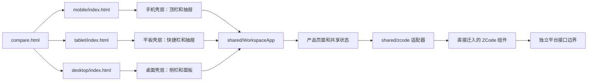

# ZCode 源码迁移与三端目录

来源：ZCode `29628c9acdb81b703bbd4080c207a0e7ce5e276e`，MIT 许可。源仓库保持只读。直接复制清单为 `zcode_sources.json`，既有设置/渠道适配的来源记录继续保留，不改写成“原样迁入”。

## CodeGraph 核对的实现链

CodeGraph 索引覆盖 4,106 个文件、100,705 个节点、276,516 条边。本次查询覆盖根工作区、侧栏、插件发现、远程连接、目录导航和服务边界，并读取当前磁盘上的对应源码。以下路径均相对 ZCode 仓库。

| 用户操作 | 上游实现链 | TinyClaw 接入位置 |
|---|---|---|
| 工作区与侧栏 | `packages/ui/src/Root.tsx` → `app-shell/WorkspaceShellLayout.tsx` → `WorkspaceSidebar.tsx` / `WorkspaceHeader.tsx` | 三端壳层分别管理布局；完整上游根壳尚未接入 |
| 浏览插件 | `PluginStorePage` → `settings/PluginStoreListView.tsx` → `PluginStoreCard.tsx` → 安装按钮、操作菜单 | `shared/PluginMarket.jsx` → `shared/zcode/PluginDirectory.jsx` → 原版列表与卡片 |
| 插件查找与分组 | `settings/pluginSearch.ts`、`pluginStoreListing.ts` → `packages/shared/src/pluginStoreOrdering.ts`、`plugin-display-name.ts`、`plugin-marketplaces.ts` | 原样使用拼音搜索、公共/个人分段、分类排序和来源命名 |
| 添加远程项目 | `SSHDialog.tsx` → `RemoteConnectionDialogContent.tsx` / `RemoteConnectionWizardChrome.tsx` → `RemoteConnectionFields.tsx` → `hooks/useRemoteConnectionForm.ts` | `shared/AddProject.jsx` → `shared/zcode/ZCodeRemoteProject.jsx` → 原版方式/配置视图和表单 hook |
| 浏览目录 | `DirectoryBrowser.tsx` → `systemService.info()` / `fileService.readdir()` | 原版目录导航、隐藏目录、请求过期保护；预览适配器提供显式模拟目录 |
| 真实服务 | `hooks/useServices.tsx` / `packages/shared/src/platform.ts` → `packages/services/src/zcode-session/zcodeSessionService.ts` | 尚未接入 AgentScope 运行端 |
| 真实远程连接 | `packages/desktop/src/host/windowRemoteConnectionRegistry.ts` → `packages/server/src/remote/connect.ts`、`ssh-backend.ts`、`docker-backend.ts` | 预览不会建立 SSH/Docker 连接，不把模拟成功当成真实连接 |



## 目录归属

- `mobile/`：手机入口、手机工作区布局。
- `tablet/`：平板入口、平板工作区布局。
- `desktop/`：桌面入口、桌面工作区布局和桌面样式。
- `shared/`：工作区状态、任务输入、页面、主题和公共操作。
- `shared/settings/`：既有设置及其 ZCode 抽取组件。
- `shared/channels/`：三端共同使用的设备配对、远程控制与机器人渠道；不再归手机端独占。
- `shared/zcode/ui/`：本次从 `packages/ui/src` 直接复制的 TSX、工具、译文和资产。
- `shared/zcode/shared/`：从 `packages/shared/src` 直接复制的纯函数。`index.ts` 是 TinyClaw 的选择性导出文件。
- `shared/zcode/adapters/`：国际化、平台发现、预览目录、日志和操作桥接。插件菜单以非模态方式嵌入，避免 Radix 菜单与 Ant Design 抽屉同时锁定焦点；菜单组件源码不改写。
- `compare.html`：只组合三端构建产物，三个入口各有独立 React 实例。

## 复制、抽取和适配边界

本次清单包含 **50 个来源文件**：48 个逐字复制，2 个明确抽取。抽取项为 `RemoteConnectionDialogContent.tsx` 的方式/配置两步，以及 `styles.css` 的完整 `@theme` 定义。适配器不计入原样复制数量。保留原版 Radix/Lucide/Tailwind 实现；三端布局与已确认的 TinyClaw 色板通过独立 CSS 适配。

插件列表仍使用原有 `resources` 作为唯一安装事实源。适配器按目录身份和安装范围关联安装实例，原版菜单的启停、模拟更新、确认卸载回写相同状态；详情、清单导入和仓库管理继续复用既有产品流程。没有另建一套“市场安装状态”。

远程表单沿用上游主机/用户/认证方式校验、SSH 配置别名、Docker 发现失败处理和手动容器输入。浏览器没有宿主时明确报不可用；密码与密钥字段只留在挂载的表单组件中，不传入目录适配器，不写入 localStorage。目录样例只在主动点击“模拟连接，继续”后显示。

既有 `shared/settings/zcode/manifest.json`（24 项）及 `shared/channels/zcode/manifest.json`（6 项）是经 Agent Buddy 适配后继承的上游抽取结果。本次仅迁移目录及必要导入路径，保留原始来源说明。桌面壳层、会话渲染、输入框、账户和部分设置仍有 TinyClaw/Agent Buddy 适配代码，**不能将整个 UI 说成已经完整搬入 ZCode**。

## 可复现验证

在 `ui/` 运行：

```sh
npm ci
npm test
npm run check:provenance
npm run check:migration
npm run preview
```

`npm test` 先构建三端和对比入口，再运行 Node 测试；构建生成的 `build_meta/` 和 `shared/zcode/generated.css` 不入库。迁移检查同时核对文件哈希和三端产物中的实际代码字节，避免只复制文件而未接入构建。

从仓库根核对源 checkout：

```sh
node ui/scripts/check_zcode_migration.mjs --source=../research/ZCode
```

同步脚本 `ui/scripts/sync_zcode_sources.py --source ../research/ZCode` 仅接受锁定提交，将覆盖清单中的迁入文件；更新上游前应先审阅差异和调整适配器。

浏览器验收脚本：`tests/check_zcode_migration.py`（远程表单、目录、插件往返、明暗主题、三端尺寸），`check_plugin_directory.py`（仓库/清单/安装范围/启停/更新/卸载），`check_add_project.py`（本地目录选择与重名），以及主导航、独立入口、设置切换和快捷键回归。测试图片仅写入临时目录，不作为产品资产。

## 尚未完成的整体验收

完整 `Root` / `WorkspaceShellLayout`、V4 会话与编辑器、全部设置宿主编排尚未整体迁入；真实插件包加载、仓库拉取、MCP 进程、PTY、AgentScope 会话和 SSH/Docker 后端尚未接入。这些需要继续沿上述服务接口迁移并增加真实运行端验收，不能由当前浏览器预览和构建通过代替。
